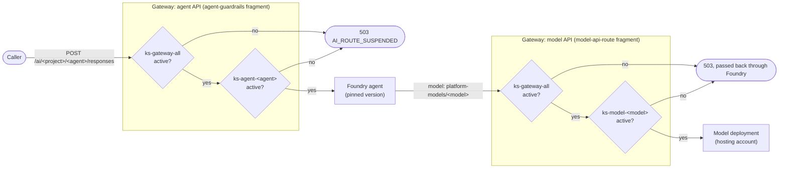

# Agent deployment

Deploys Microsoft Foundry prompt agents from Git, gates each new version with a Foundry evaluation, and
publishes them on the AI gateway (Azure API Management) with developer documentation in the APIM Developer
Portal.

**One Foundry project = one API. Each agent in the project = one operation of that API.**

```
POST https://<apim>.azure-api.net/ai/<project>/<agent>/responses
```

Merge a change under `projects/<project>/` → GitHub Actions, per changed project:

1. **Validate** the project and agent definitions.
2. **Deploy to Foundry** — a new agent version only for agents whose model, instructions or description changed.
   The gateway keeps serving the previous version.
3. **Evaluate (gate)** — a Foundry evaluation of each new version against its `evals.yaml` dataset with the
   built-in evaluators it lists (intent resolution, task adherence, relevance, coherence, groundedness). Every evaluator must reach
   `min_pass_rate`; otherwise the run stops and the gateway stays on the previous version. Runs appear on the
   agent's **Evaluations** tab in Foundry.
4. **Register in the AI gateway** — named values per agent (`agent-name-<agent>`, **`agent-version-<agent>`**
   pinned to the evaluated version, kill switch `ks-agent-<agent>`), the project API imported from a generated
   OpenAPI spec (one operation per agent), the project and agent policies, the product.
5. **Publish developer docs** — `project.md` becomes the API description and each agent's `docs.md` its
   operation description; the Developer Portal is republished.
6. **Smoke test** — every agent's `tests.yaml` through the gateway.

## Models: onboarding and access

Models are hosted in separate model-hosting Foundry accounts and reach agents only through the AI gateway.
**Model platform deployment** (`gateway/foundry-accounts/**`) deploys and registers a model; **model project connection**
(`models:` in `projects/<project>/project.yaml`) gives a project's agents the models it lists, with token limits,
through an AI Gateway connection (`model: platform-models/<model>`). Both are Terraform stacks with their own
workflows. See [gateway/README.md](gateway/README.md), including the [pipeline flow](gateway/README.md#pipeline-flow-what-happens-when-they-run). Platform coordinates per environment are in
[platform/environments/](platform/environments/README.md).

## Layout

| Path | What it is |
|---|---|
| `projects/<project>/project.yaml` | Foundry project endpoint, gateway path, product, project rate limit and quota |
| `projects/<project>/project.md` | API documentation in the Developer Portal |
| `projects/<project>/agents/<agent>/agent.yaml` | name, description, owner, model, agent rate limit and quota |
| `projects/<project>/agents/<agent>/instructions.md` | the agent's instructions |
| `projects/<project>/agents/<agent>/docs.md` | operation documentation in the Developer Portal |
| `projects/<project>/agents/<agent>/evals.yaml` | evaluation gate: judge model, minimum pass rate, evaluators, dataset |
| `projects/<project>/agents/<agent>/tests.yaml` | smoke tests (`input`, `must_contain_any`) |
| `templates/project-policy.xml` | API policy: this project's limits, then the shared `project-inbound` / `project-outbound` fragments |
| `templates/agent-operation-policy.xml` | operation policy: this agent's values (kill switch, limits, name, pinned version), then the shared `agent-guardrails` / `agent-pin-version` fragments |
| `gateway/policy-fragments/<id>.xml` | the shared policy logic for agent APIs and project model APIs, one APIM policy fragment per file, deployed by `gateway-policy-deployment` (see below) |
| `scripts/agent_pipeline.py` | `validate`, `deploy`, `evaluate`, `register`, `smoke` |
| `.github/workflows/agent-ci.yml` | pull requests: validate |
| `.github/workflows/agent-deploy.yml` | main: every changed project (one at a time); or run on demand for one project |
| `gateway/` | model platform deployment, gateway policy deployment (shared policy fragments) and model project connection (Terraform), see [gateway/README.md](gateway/README.md) |
| `platform/environments/<env>.yaml` | platform coordinates per environment |
| `.github/workflows/model-platform-deployment.yml`, `model-project-connection.yml` | the two model pipelines |
| `.github/workflows/gateway-policy-deployment.yml` | the shared gateway policy fragments, every environment (stack `gateway/terraform/gateway-policies`) |

## Shared policy (policy fragments)

The gateway logic every agent shares (kill switch check, rate limit, forwarding to Foundry with managed identity,
pinning the evaluated version) is in APIM **policy fragments**, one per file in `gateway/policy-fragments/`.
Each agent operation and project API policy only sets its own values as context variables and includes the fragments:

```xml
<set-variable name="agent" value="expense-policy-agent" />
<set-variable name="agent-status" value="{{ks-agent-expense-policy-agent}}" />
<set-variable name="agent-rate" value="@(30)" />  ...
<include-fragment fragment-id="agent-guardrails" />
<quota-by-key calls="2000" renewal-period="86400" counter-key="..." />
<base />
<include-fragment fragment-id="agent-pin-version" />
```

| Change | Pipeline | Agents redeployed |
|---|---|---|
| `gateway/policy-fragments/*.xml` (shared logic) | `gateway-policy-deployment`: plan on the PR, apply on merge (environment approval), for **every** environment; then smoke-tests every project model API and agent on that gateway | none: every agent and model API uses the new fragment at once |
| `templates/*.xml` (which values are passed, which fragments are included) | `agent-deploy`, every project | all |
| an agent's limits or version | `agent-deploy`, that project | that project |

| Fragment | Included by | Does |
|---|---|---|
| `agent-guardrails` | agent operation policy, before `<base />` | global kill switch `ks-gateway-all` and agent kill switch (503), agent rate limit |
| `agent-pin-version` | agent operation policy, after `<base />` | fixes `agent_reference` to the evaluated version |
| `project-inbound` | project API policy | project rate limit, correlation ID, Responses API, managed identity |
| `project-outbound` | project API policy, project model API policy | correlation ID on the response |
| `model-api-caller` | project model API policy (`gateway/terraform/project-connection`) | only the project's Foundry identity (token claim `xms_mirid`; tenant from named value `gateway-tenant-id`) |
| `model-api-route` | project model API policy, after its routing table | global kill switch `ks-gateway-all` (503), 404 `MODEL_NOT_ALLOWED`, model kill switch, token limit, backend, managed identity |

The project model API policy keeps only its routing table (allowed models with their kill switch, token limits,
backend and deployment).

The daily quotas (`quota-by-key`) stay in the agent operation and project policies, with literal values: APIM accepts
no policy expression in `quota-by-key calls`. The rate limits and token limits take their values from context
variables (`llm-token-limit token-quota` must be a `long`, hence `@(…L)`).

### How the fragments are deployed

Only the `gateway-policy-deployment` workflow writes fragments (Terraform stack `gateway/terraform/gateway-policies`,
state `ai-gateway-policies-<env>.tfstate`), together with the named values they read directly: `gateway-tenant-id`
and the global kill switch `ks-gateway-all` (see [Kill switches](#kill-switches)). It runs for **every** environment in `platform/environments/`, in that
environment's model GitHub environment (`test` → `model-test`), filtered by `MODEL_ENVIRONMENTS` when set:

1. Pull request: format, validate, plan tests, and a plan per environment. The plan fails if a policy template
   (`templates/*.xml`, `gateway/terraform/project-connection/policies/*.tftpl`) includes a fragment with no file.
2. Merge to `main`: plan → approval → apply → smoke tests of every project model API and agent on that gateway.

The other pipelines only reference fragments by name. `agent-deploy` (`register`) and the `model-project-connection`
plan check that the fragments they include are on the gateway, and stop with "run gateway-policy-deployment first"
if not.

### Change the shared policy

1. Edit `gateway/policy-fragments/<id>.xml` (the file name is the fragment ID; the root element is `<fragment>`).
   A fragment reads its inputs from context variables; the comment at the top of each file lists them.
2. Open a pull request and review the plan of every environment.
3. Merge and approve the apply per environment. Every agent and model API uses the new logic at once.

A fragment change has no evaluation gate and reaches every project at once: review it like platform code. A new
fragment must be deployed (merged and applied) before a template that includes it is merged.

## Projects and where they run

| Project | Environment | Foundry project | Gateway API | Models |
|---|---|---|---|---|
| `models-demo` | `sandbox` | `aif-sbx-agents-bbf0o/models-demo` | `ai/models-demo` (product `agents-sandbox`) | `platform-models/gpt-5.4-mini`; owns the project's AI Gateway connection and token allocation (`models:`) |
| `proj-default` | `sandbox` | the same `aif-sbx-agents-bbf0o/models-demo` project (the sandbox has two Foundry accounts, agents and models; its only project, `models-demo`, is in the agents account) | `ai/proj-default` (product `agents-sandbox`) | `platform-models/gpt-5.4-mini` through `models-demo`'s connection; no `models:` section, so its tokens count against `models-demo`'s allocation |

The agent-only Foundry account has no model deployments: every agent, and every evaluation judge, uses its model
through the AI gateway (`models/models-demo` → hosting account `aif-sbx-models-bbf0o`). `proj-default`'s earlier
deployment in the test environment (`az-aif-tst-model-npr-01/proj-default`, gateway `apim-agents-3471ad`) is left
untouched by the pipeline; that gateway is currently suspended in Azure, so it serves nothing.

## Add an agent

1. Copy `projects/proj-default/agents/leave-policy-agent` to `projects/<project>/agents/<new-agent>`
   (lowercase, digits, hyphens).
2. Edit `agent.yaml` (name must match the folder), the instructions, docs, evaluation dataset and smoke tests.
3. Open a pull request; `agent-ci` validates it. Merge to deploy.

## Add a project

Create `projects/<project>/project.yaml` (endpoint of the Foundry project, `gateway.path` = `ai/<project>`)
and `project.md`, then add agents. A project's consumers subscribe to its product; one key covers every agent
in the project. Put an agent in its own project when it needs a different audience.

## Kill switches

A **kill switch** is an emergency stop on the AI gateway. Flipping it takes effect within seconds, with no
deployment, no pipeline run and no change in Git: the gateway simply refuses the calls it covers and answers
`503 AI_ROUTE_SUSPENDED`. Use it when an agent or a model misbehaves (wrong or harmful answers, a data leak, a
runaway cost, an incident at the model provider) and you need it stopped *now*, before anyone has worked out a fix.

### The three switches

Each switch is an APIM **named value** whose value is `active` or anything else (by convention `suspended`).

| Switch (named value) | Stops | Who is affected | Created by |
|---|---|---|---|
| `ks-gateway-all` | **everything** on the gateway: every agent and every project model API | every caller of every project | `gateway-policy-deployment` (one per gateway) |
| `ks-model-<model>` | one **model** (e.g. `ks-model-gpt-5-4-mini`) | every agent and evaluation of every project that uses the model | `model-platform-deployment` (one per model) |
| `ks-agent-<agent>` | one **agent** (e.g. `ks-agent-expense-policy-agent`) | callers of that agent only; the project's other agents keep working | `agent-deploy` (`register`, one per agent) |

Use the narrowest switch that stops the problem: an agent's switch for a bad agent, a model's switch for a bad
model, the global switch only when you can't tell yet what is wrong or everything must stop.

### Where each switch is checked

An agent call crosses the gateway twice: once on the way in (the agent API), and once more when the agent calls its
model (the project's model API, through the AI Gateway connection). The switches are checked on those hops:



- **Fails closed.** Anything other than exactly `active` (case-insensitive) stops the route: `suspended`, `off`, a
  typo. A missing switch can't happen silently: APIM refuses to save a policy that refers to a named value that
  doesn't exist.
- **Before any cost.** The check comes before limits, Foundry and the model, so a suspended route uses no tokens.
- **Evaluations too.** The evaluation gate's judge reaches the model through the same model API, so a suspended
  model (or the global switch) also stops evaluations; the pipeline run then fails and the gateway keeps serving the
  previous agent version.

The *check* is in the shared policy fragments (`agent-guardrails`, `model-api-route`), so it is the same for every
agent and model. The *value* of `ks-agent-<agent>` and `ks-model-<model>` is read by each agent's or project's own
policy and handed to the fragment, because APIM resolves `{{named value}}` references when a policy is saved, not
per request. `ks-gateway-all` has a fixed name, so the fragments read it directly.

### What the caller sees

```http
HTTP/1.1 503 Service Unavailable
Retry-After: 300
Content-Type: application/json

{"error": {"code": "AI_ROUTE_SUSPENDED",
           "message": "This agent is suspended by the platform kill switch.",
           "correlationId": "..."}}
```

The message says which switch stopped the call: *This agent is suspended…*, *Model `<model>` is suspended…* or
*All AI routes on this gateway are suspended…*. A model or global stop on the second hop reaches the caller through
Foundry as a failed agent response.

### Stop and resume

In the Azure portal: **API Management → Named values → `<switch>` → Edit → value `suspended` → Save**. Set it back
to `active` to resume. With the Azure CLI (sandbox names shown):

```bash
# stop
az apim nv update -g rg-ai-gateway-sandbox -n apim-sbx-bbf0o --named-value-id ks-agent-expense-policy-agent --value suspended
# check
az apim nv show   -g rg-ai-gateway-sandbox -n apim-sbx-bbf0o --named-value-id ks-agent-expense-policy-agent --query value
# resume
az apim nv update -g rg-ai-gateway-sandbox -n apim-sbx-bbf0o --named-value-id ks-agent-expense-policy-agent --value active
```

The change reaches the gateway within seconds. Anyone who can edit the APIM instance's named values (Owner, Contributor or
**API Management Service Contributor** on it) can flip a switch; keep that list short.

### What the pipelines do with switches

- They **create** each switch `active`, once, and **never change it afterwards**. No deployment, apply or re-run
  ever re-enables a suspended route; resuming is always a deliberate human action.
- Smoke tests **skip** what is suspended instead of failing: a suspended agent is skipped by `agent_pipeline.py
  smoke`; with `ks-gateway-all` suspended, the agent smoke test and the agent part of the model access smoke test
  are skipped (the access-control check still runs).
- Deploying while a switch is suspended is allowed: a new agent version can be deployed, evaluated (if its model is
  active) and pinned, and goes live when the switch is set back to `active`.

### What a kill switch does not do

- It stops traffic **through the gateway** only. Someone with direct access to the Foundry project (Foundry User)
  can still call the agent there; agent-only accounts have no models, so such a call fails once the model or the
  global switch is suspended.
- It doesn't roll anything back or delete anything: the agent, its versions and the model deployment stay as they
  are. To fix the cause, change the agent (or roll back `agent-version-<agent>`, see below) and resume.

## Version served

The gateway serves the agent version in the named value `agent-version-<agent>`. Only the pipeline moves it, and
only to a version that passed evaluation in the same run. To roll back, set it to an earlier version (or revert the change in Git and merge).

## Environments (`sandbox`, `agent-test`)

Projects with `environment: sandbox` run in the GitHub environment `sandbox` (APIM `apim-sbx-bbf0o`, pipeline
identity `id-sbx-pipeline`, see [gateway/README.md](gateway/README.md#sandbox)). Both projects currently do.
Projects without `environment:` run in `agent-test` (none at the moment; its gateway `apim-agents-3471ad` is
suspended and has no shared policy fragments, so `register` would stop there):

| Variable | Value |
|---|---|
| `APIM_NAME` / `APIM_RESOURCE_GROUP` | `apim-agents-3471ad` / `az-rg-tst-model-npr-01` |
| `AZURE_CLIENT_ID`, `AZURE_TENANT_ID`, `AZURE_SUBSCRIPTION_ID` | managed identity `id-promptops-pipeline`, signed in with GitHub OIDC (no secrets) |

The Foundry project endpoint is in each `project.yaml`. The identity needs **Foundry User** on the Foundry
account (agents and evaluations) and **API Management Service Contributor** on the APIM instance. Its federated
credential `github-agent-deployment` trusts
`repo:DeepuMM@3176338/agent-deployment@1445709242:environment:agent-test`; update it if the repo moves.
APIM's own managed identity needs **Foundry User** on the Foundry account so the gateway can call the agents.

## One-time setup per APIM instance

- **Developer Portal:** open it once from the Azure portal (APIM → Developer portal) so Azure provisions it;
  after that every deployment publishes it.
- **Sign-in (test, `apim-agents-3471ad`):** the portal uses Microsoft Entra ID (app registration
  `apim-agents-3471ad developer portal`); self sign-up with email and password is off. Renew the app secret before
  it expires (November 2027). The sandbox portal (`apim-sbx-bbf0o`) shows the products to anonymous
  visitors too (`portal_anonymous: true`).
- **Shared policy fragments:** run `gateway-policy-deployment` for the environment before the first `agent-deploy`.

## Run locally

```bash
pip install -r scripts/requirements.txt
az login
# sandbox: the subscription in platform/environments/sandbox.yaml, rg-ai-gateway-sandbox, apim-sbx-bbf0o
export AZURE_SUBSCRIPTION_ID=... APIM_RESOURCE_GROUP=rg-ai-gateway-sandbox APIM_NAME=apim-sbx-bbf0o
python scripts/agent_pipeline.py validate
python scripts/agent_pipeline.py deploy   proj-default
python scripts/agent_pipeline.py evaluate proj-default
python scripts/agent_pipeline.py register proj-default
python scripts/agent_pipeline.py smoke    proj-default
```
