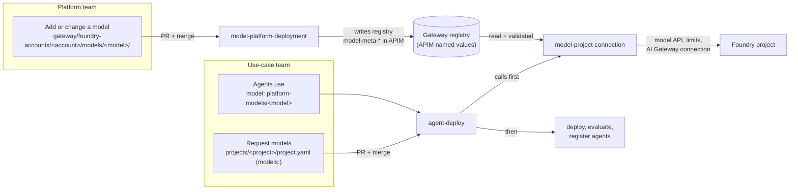
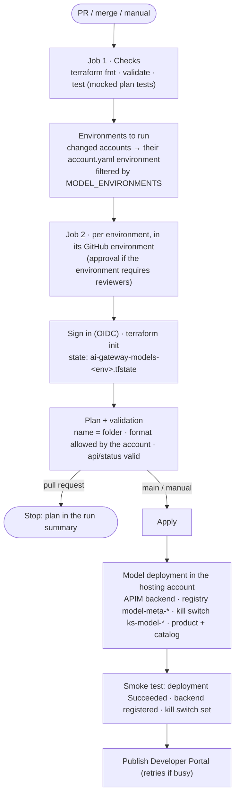
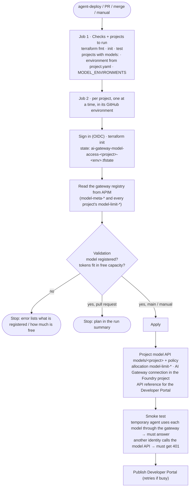
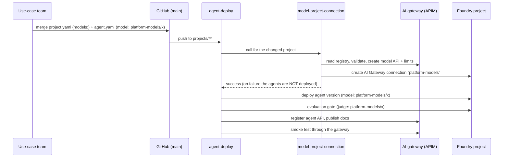

# AI gateway: model platform deployment, gateway policy deployment and model project connection

Models are hosted **once**, in model-hosting Foundry accounts, and served **only through the AI gateway**
(Azure API Management). Foundry accounts that hold agents have **no model deployments**: their projects reach
models through an *AI Gateway connection*, and their agents use `"<connection>/<model>"`, e.g.
`platform-models/gpt-5.4-mini`. An organisation may use the same Foundry instance for both; the folders below
keep the two roles apart either way.

Two model pipelines, owned by different teams and run at different times. A third, **gateway policy deployment**,
deploys the shared policy fragments that the model APIs and agent APIs include ([below](#gateway-policy-deployment-shared-policy-fragments)).

| | **Model platform deployment** (P2) | **Model project connection** (part of use-case onboarding, P3) |
|---|---|---|
| Question | Is this model available on the platform? | Can this project use this model, and how much? |
| Change | `gateway/foundry-accounts/<account>/models/<model>/` | `models:` in `projects/<project>/project.yaml` |
| Owner | Platform team | Use-case team requests by pull request; platform team approves |
| Workflow | `.github/workflows/model-platform-deployment.yml` | `.github/workflows/model-project-connection.yml`, called by `agent-deploy` **before** it deploys the project's agents |
| Terraform stack | `gateway/terraform/platform-deployment` | `gateway/terraform/project-connection` (one state per project) |
| State file | `ai-gateway-models-<env>.tfstate` | `ai-gateway-model-access-<project>-<env>.tfstate` |

A new model is available to nobody until a project asks for it. A project can only ask for a model that the
gateway has registered.

```
gateway/foundry-accounts/<account>/models/<model>/          projects/<project>/project.yaml  (models:)
        │  model-platform-deployment                                │  model-project-connection
        ▼                                                           ▼
  deployment in <account> ◄── APIM backend ◄──── models/<project> API ◄──── AI Gateway connection in the project
  (capacity, guardrail)       registry model-meta-<model>  (token check, kill    "platform-models"; agents use
                              kill switch ks-model-<model> switch, token limits)  model: platform-models/<model>
```

## Pipeline flow: what happens when they run

### The big picture



### model-platform-deployment

**Triggers**

| Event | What runs |
|---|---|
| Pull request touching `gateway/foundry-accounts/**`, `gateway/terraform/platform-deployment/**` or `platform/environments/**` | checks and plan only; the plan is shown in the run summary |
| Merge to `main` with the same paths | checks, plan, **apply**, smoke test, Developer Portal |
| Manual (`workflow_dispatch`) | the same as main, for every enabled environment |



| Step | What it does | Fails when |
|---|---|---|
| Checks | Terraform format, validate, plan tests with mocked Azure | a file is badly formatted or a test fails |
| Environments to run | one run per platform environment of the changed hosting accounts (`account.yaml`), only if listed in `MODEL_ENVIRONMENTS` | — (nothing to run: the job is skipped) |
| Sign in + init | GitHub OIDC as the environment's pipeline identity; Terraform state in the environment's storage | the identity or its federated credential is missing |
| Plan | computes the changes and validates every `model.yaml` | a name, format, `api` or `status` is invalid |
| Apply | deploys or updates each model in its hosting account; creates or updates its backend, registry entry, kill switch (only created, never re-enabled) and the product with the catalog | Azure refuses (quota, permissions) |
| Smoke test | reads the registry back from APIM and checks each model's deployment, backend and kill switch | a deployment isn't `Succeeded`, a backend is missing |
| Portal | publishes the Developer Portal | the portal is disabled on the APIM instance |

### model-project-connection

**Triggers**

| Event | What runs |
|---|---|
| A project's `project.yaml` merged to `main` | **called by `agent-deploy`** for that project, *before* its agents are deployed |
| Pull request touching `projects/*/project.yaml` | checks and plan only (validation against the live registry) |
| Merge to `main` touching `gateway/terraform/project-connection/**` | re-runs every project that has a `models:` section |
| Manual (`workflow_dispatch`, input `project`) | the same as main, for that project |



| Step | What it does | Fails when |
|---|---|---|
| Checks + projects to run | Terraform format and plan tests; picks the projects (with a `models:` section) and each one's environment | a test fails |
| Sign in + init | OIDC as the environment's pipeline identity; one state file per project | identity or credential missing |
| Read registry | lists the gateway's named values: registered models (`model-meta-*`) and other projects' allocations (`model-limit-*`) | APIM unreachable |
| Validation | every requested model is registered; requested tokens per minute ≤ capacity − other projects' shares; sensible limits | a model isn't registered, or not enough free capacity |
| Apply | the project's model API with its policy (its routing table; the shared fragments `model-api-caller` and `model-api-route` enforce this project's identity, kill switch, token limits and routing), its allocation, and the AI Gateway connection `platform-models` in the Foundry project | a shared fragment is missing on the gateway (the plan stops first), or Azure refuses |
| Smoke test | a temporary agent in the project with `model: platform-models/<model>` must answer each `tests.yaml` prompt; another identity calling the model API must be refused (401); the agent is deleted afterwards | the agent can't reach the model, or the API accepts another caller |
| Portal | publishes the Developer Portal | portal disabled |

### How agent-deploy uses it



## Environments

Every definition says which platform environment it belongs to, and each pipeline run targets that environment's
Azure resources through the GitHub environment of the same name:

| Definition | Field | Default |
|---|---|---|
| `gateway/foundry-accounts/<account>/account.yaml` | `environment` | required |
| `projects/<project>/project.yaml` | `environment` | `test` |

| Platform environment | Coordinates | GitHub environment (model pipelines / agent pipeline) |
|---|---|---|
| `test` | `platform/environments/test.yaml` | `model-test` / `agent-test` |
| `sandbox` (disposable, `gateway/sandbox`) | `platform/environments/sandbox.yaml` | `sandbox` / `sandbox` |

The gateway policy deployment runs in the model GitHub environment (`model-test`, `sandbox`).

Each GitHub environment holds `AZURE_CLIENT_ID`, `AZURE_TENANT_ID`, `AZURE_SUBSCRIPTION_ID` (and `APIM_NAME`,
`APIM_RESOURCE_GROUP` for the agent pipeline). The repository variable **`MODEL_ENVIRONMENTS`** (e.g. `sandbox` or
`sandbox,test`) lists the environments the model pipelines and the gateway policy deployment may run in (currently
`sandbox`): add an environment only once its GitHub environment and pipeline identity are set up. `scripts/matrix.py` builds the job matrices from these fields.

## Developer Portal (APIM)

| What developers see | Where it comes from |
|---|---|
| Product **Platform models**: catalog of every model (summary, status, region, content safety, capacity, name to use in an agent) | model platform deployment: the first paragraph of each `docs.md` (stored in the registry as `summary`) |
| API **Models - &lt;project&gt;**: the project's models with its limits, and the chat completions reference (parameters, request example, error codes) | model project connection: OpenAPI spec generated from the registry and `project.yaml` |

Both pipelines publish the portal after each apply (`gateway/scripts/publish_portal.py`, which retries when another
run is publishing). The product is visible to the **Developers** group (signed-in users); with
`gateway.portal_anonymous: true` in the environment file (and GitHub variable `PORTAL_ANONYMOUS=true` for the agent
pipeline) also to **Guests**, for a portal without sign-in (the sandbox). The portal must be enabled on the APIM
instance (`developerPortalStatus`; v2 tiers start disabled): the publish step fails with the fix if it isn't. A new APIM instance's portal must be opened once from the Azure portal
(APIM > Developer portal) before it can be published; until then the script warns instead of failing.

## Single source of truth: the gateway

The **model registry is in APIM**, not in Git: model platform deployment writes one named value `model-meta-<model>` per
model, and everything that needs to know which models exist reads it from APIM:

- the model-project-connection stack (validation, backend, deployment name, capacity) through `azapi_resource_list`;
- the smoke tests (`gateway/scripts/model_smoke.py`);
- project repositories created from the template (they have no `gateway/` folder at all).

Git holds what the platform team *wants* registered; APIM holds what *is* registered, and only the pipelines
write it. A use-case team types only a model name and its limits.

| Named value in APIM | Value | Written by | Read by |
|---|---|---|---|
| `model-meta-<model>` | JSON: name, api, status, format, model, version, hosting account, region, deployment, `capacity_tpm`, guardrail, backend ID, kill switch | model platform deployment | model project connection, smoke tests, project pipelines |
| `ks-model-<model>` | `active` or `suspended` | model platform deployment (once); then operations only | the project model API policies |
| `ks-gateway-all` | `active` or `suspended`: stops every agent and model API on the gateway | gateway policy deployment (once); then operations only | the fragments `agent-guardrails` and `model-api-route` |
| `model-limit-<project>-<model>` | JSON: project, model, `tokens_per_minute`, `tokens_per_day` | model project connection | model project connection of every other project (free capacity) |

APIM names allow no dots, so `<model>` in these names is the model name with dots replaced by hyphens
(`gpt-5.4-mini` → `gpt-5-4-mini`). The registry entry keeps the real name.

## Model platform deployment

### Add or change a model

1. Create `gateway/foundry-accounts/<account>/models/<model>/` (or edit it):

   | File | What it is |
   |---|---|
   | `model.yaml` | gateway model name (= folder name), API, status, model (format, name, version), deployment (name, SKU, capacity, version upgrade, `existing`), guardrail |
   | `docs.md` | model card for the developer portal |
   | `tests.yaml` | smoke tests run through the gateway by an agent that uses the model |

2. Open a pull request: `model-platform-deployment` checks format, validates, runs the plan tests and shows the plan.
3. Merge to main: plan, **approval** on the environment's GitHub environment (`model-test`, `sandbox`), apply, smoke test.

A new hosting account (e.g. another region for Claude Sonnet) is a new folder
`gateway/foundry-accounts/<account>/` with `account.yaml` (subscription, resource group, region, allowed model
formats). Only folders under `gateway/foundry-accounts/` can receive models, so a model can never be deployed
into an agent account.

### What it creates per model

| Resource | Name | Notes |
|---|---|---|
| Model deployment | `deployment.name` in the hosting account | SKU, capacity, guardrail (`raiPolicyName`), version upgrade. `existing: true` adopts a deployment made before this pipeline (Terraform `import`) instead of recreating it |
| APIM backend | `model-<account>-<deployment>` | `https://<account>.cognitiveservices.azure.com/openai` |
| Registry entry | named value `model-meta-<model>` | see above |
| Kill switch | named value `ks-model-<model>` | created `active`; later changes are never overwritten by an apply |
| Product | `platform-models` (from the environment file) | catalog of every model in its description; visible to the Developers group; every project's model API is added to it |

### Validation (fails the plan before anything changes)

- `model.yaml` `name` equals its folder name; names are lowercase letters, digits, dots and hyphens.
- The model's format is one of its hosting account's `formats`.
- `api` is `openai`; `status` is `active` or `deprecated`.

## Model project connection for a project

### Request a model

In `projects/<project>/project.yaml`:

```yaml
models:
  connection: platform-models          # AI Gateway connection created in the project
  allowed:
    - name: gpt-5.4-mini               # a gateway model name from the registry
      tokens_per_minute: 20000         # this project's share of the model's capacity
      tokens_per_day: 2000000
```

Agents then set `model: platform-models/gpt-5.4-mini` (and the evaluation judge `judge_model` the same way):
`agent-ci` rejects any other model in a project that has a `models:` section.

Open a pull request: `model-project-connection` plans the change **against the live registry**, and `agent-ci` validates the
agents. Merge to main: `agent-deploy` first calls `model-project-connection` for the project (approval, apply, smoke test), so
the connection and limits exist before the agents that use them are deployed. If model project connection fails, the agents
aren't deployed. A change to the model-project-connection stack itself re-runs every project that lists models.

### What it creates per project

| Resource | Name | Notes |
|---|---|---|
| Model API | `models-<project>`, path `models/<project>` | imported OpenAPI: `POST /deployments/{model}/chat/completions`, description with the project's models and limits (Developer Portal); no subscription key: the caller's Entra token is checked |
| API policy | from `terraform/project-connection/policies/project-models-api.xml.tftpl` | see below |
| Product link | `platform-models` | |
| Allocation | named value `model-limit-<project>-<model>` per model | read by other projects' capacity check |
| AI Gateway connection | `models.connection` in the Foundry project | category `ApiManagement`, auth `ProjectManagedIdentity` (audience `https://cognitiveservices.azure.com`), target `https://<apim>/models/<project>`, `deploymentInPath: "true"`, static model list = the allowed models |

### Gateway policy, in order

The project's policy holds only its values (its resource ID and a routing table of the allowed models: kill switch
named value, token limits, backend, deployment). Steps 1 and 2–6 are the shared policy fragments `model-api-caller`
and `model-api-route`, deployed by `gateway-policy-deployment` (see below); changing them re-runs no project.

1. **Only this project.** `validate-azure-ad-token`: tenant from named value `gateway-tenant-id`, audience
   `https://cognitiveservices.azure.com`, and the token's `xms_mirid` claim must be the project's resource ID.
   Any other caller gets `401`.
2. **Allowed models only.** Any model not in `models.allowed` gets `404 MODEL_NOT_ALLOWED`.
3. **Kill switches.** If the global switch `ks-gateway-all` or the model's `ks-model-<model>` is not `active`:
   `503 AI_ROUTE_SUSPENDED`, for every project at once (see [Kill switches](../README.md#kill-switches)).
4. **Token limits.** `llm-token-limit` per project and model: `tokens_per_minute` and a daily `token-quota`
   (`429` when exceeded, header `x-ratelimit-remaining-tokens`).
5. **Route.** Backend `model-<account>-<deployment>`, deployment name from the registry.
6. **Authenticate to the model** with APIM's own managed identity. The project's token is never forwarded, so
   projects need no access to the hosting accounts.

### Validation (fails the plan before anything changes)

- At least one model is listed; `tokens_per_minute > 0` and `tokens_per_day >= tokens_per_minute`.
- Every listed model is in the gateway registry. The error lists what *is* registered.
- **Capacity:** the other projects' allocations plus this request fit in the model's `capacity_tpm`. The error
  says how much is free.

## Gateway policy deployment (shared policy fragments)

The policy logic shared by every project model API, project agent API and agent operation is in APIM policy
fragments, one per file in `gateway/policy-fragments/`. Their own pipeline deploys them to **every** environment's
gateway; the agent and project pipelines only write thin policies that include them by name.

| | |
|---|---|
| Change | `gateway/policy-fragments/<id>.xml` (file name = fragment ID) |
| Workflow | `.github/workflows/gateway-policy-deployment.yml` |
| Terraform stack | `gateway/terraform/gateway-policies` (fragments and the named values `gateway-tenant-id` and `ks-gateway-all`, the global kill switch) |
| State file | `ai-gateway-policies-<env>.tfstate` |
| Environments | every `platform/environments/<env>.yaml`, in its model GitHub environment (`test` → `model-test`), filtered by `MODEL_ENVIRONMENTS` |

| Step | What it does | Fails when |
|---|---|---|
| Checks | Terraform format, validate, plan tests with mocked Azure | a file is badly formatted or a test fails |
| Plan | one fragment per file; every fragment a policy template includes (`templates/*.xml`, `project-connection/policies/*.tftpl`) must have a file | a template includes a missing fragment, or a file's root isn't `<fragment>` |
| Apply (main, after approval) | creates or updates the fragments and `gateway-tenant-id`; creates `ks-gateway-all` as `active` (never changed afterwards) | APIM rejects the XML |
| Smoke tests | `model_smoke.py access` for every project with a model API, `agent_pipeline.py smoke` for every registered project of the environment | a project can't reach its models, another identity gets in, or an agent no longer answers |

`agent-deploy` (`register`) and `model-project-connection` (plan) both check that the fragments they include are on
the gateway, and stop with "run gateway-policy-deployment first" if not. A fragment change reaches every project
at once and has no evaluation gate: review it like platform code.

## Kill switch, rollback, retirement

- **Stop a model for everyone:** APIM → Named values → `ks-model-<model>` → `suspended`. Callers get
  `503 AI_ROUTE_SUSPENDED`. No pipeline run re-enables it.
- **Stop everything on the gateway:** `ks-gateway-all` → `suspended` (every agent and model API). How the three kill
  switches (gateway, model, agent) work together: [Kill switches](../README.md#kill-switches).
- **Stop one project's access:** remove the model from its `models.allowed` (or set a very low limit) and merge.
- **Roll back a model change:** revert the commit and merge; the plan shows the change back.
- **Retire a model:** set `status: deprecated` (still served, visible in the registry and smoke test), ask the
  projects to move, then delete the folder once no `model-limit-*-<model>` remains.

## Workflows and triggers

| Change | What runs |
|---|---|
| `gateway/foundry-accounts/**`, `gateway/terraform/platform-deployment/**`, `platform/environments/**` | `model-platform-deployment` (PR: checks + plan; main: apply + smoke) |
| `gateway/policy-fragments/**`, `gateway/terraform/gateway-policies/**`, `platform/environments/**` | `gateway-policy-deployment`, every environment (PR: checks + plan; main: apply + smoke of every project) |
| `projects/<project>/project.yaml` | PR: `agent-ci` + `model-project-connection` plan. Main: `agent-deploy` → `model-project-connection` (apply, smoke, portal) → agent deploy, evaluation, gateway |
| `projects/<project>/agents/**` | `agent-ci` / `agent-deploy` (agents only) |
| `templates/**` (agent and project policy templates) | `agent-deploy` for every project |
| `gateway/terraform/project-connection/**` | `model-project-connection` for every project with a `models:` section |

## Identity and permissions

| Who | Role | Scope |
|---|---|---|
| Pipeline identity (GitHub OIDC) | Foundry Account Owner (deploy models, set guardrails) | each hosting account |
| | API Management Service Contributor | the APIM instance |
| | Foundry User + Contributor (create connections) | the agent Foundry account / its resource group |
| | Storage Blob Data Contributor | the Terraform state container |
| APIM managed identity | Foundry User (call the deployments) | each hosting account |
| Foundry project managed identity | none on the hosting accounts | it only calls APIM |

GitHub environments `model-test` (model pipelines and gateway policy deployment) and `agent-test` (agent pipeline),
with required reviewers, and `sandbox` (all pipelines, identity `id-sbx-pipeline`); variables `AZURE_CLIENT_ID`,
`AZURE_TENANT_ID`, `AZURE_SUBSCRIPTION_ID`. Everything else comes from `platform/environments/<env>.yaml`. The gateway
policy deployment's smoke tests also need the identity's Foundry User role on the agent Foundry account.

## Run locally

```bash
az login
cd gateway/terraform/platform-deployment
terraform init -backend-config="resource_group_name=rg-ai-gateway-sandbox" \
  -backend-config="storage_account_name=sttfsbxbbf0o" -backend-config="container_name=tfstate" \
  -backend-config="key=ai-gateway-models-sandbox.tfstate" -backend-config="use_azuread_auth=true"
terraform test                         # plan tests with mocked providers, no Azure access
terraform plan -var environment=sandbox  # state storage from platform/environments/sandbox.yaml

cd ../gateway-policies                             # same init with key ai-gateway-policies-<env>.tfstate
terraform test
terraform plan -var environment=sandbox

cd ../project-connection                           # same init with key ai-gateway-model-access-<project>-<env>.tfstate
terraform plan -var environment=sandbox -var project=models-demo

python gateway/scripts/model_smoke.py models sandbox
python gateway/scripts/model_smoke.py access models-demo sandbox
python gateway/scripts/publish_portal.py sandbox
```

## Sandbox

`gateway/sandbox` creates a disposable copy of the platform in one resource group: model-hosting Foundry account,
agent-only Foundry account with project `models-demo`, APIM Basic v2, Terraform state storage, and the pipeline
identity `id-sbx-pipeline` trusted by the GitHub environment `sandbox`. `platform/environments/sandbox.yaml`,
`gateway/foundry-accounts/aif-sbx-models-*/`, `projects/models-demo/` and `projects/proj-default/` point at it
(both projects use the Foundry project `models-demo`). `terraform destroy` in `gateway/sandbox` removes everything;
then delete `platform/environments/sandbox.yaml`, `gateway/foundry-accounts/aif-sbx-models-*/` and
`projects/models-demo/`, point `projects/proj-default/` at another environment, delete the `sandbox` GitHub
environment and remove `sandbox` from `MODEL_ENVIRONMENTS`.

## Tested end to end (sandbox, 13 Nov 2026)

In `gateway/sandbox` (separate hosting and agent-only Foundry accounts, APIM Basic v2), environment `sandbox`:

| Check | Result |
|---|---|
| Model platform deployment: deployment, backend, registry, kill switch, product (5 resources) | created; smoke test: deployment Succeeded, backend registered, kill switch active |
| Model project connection for `models-demo`: plan reads the registry from APIM, checks capacity (20,000 of 50,000 TPM) | 7 resources created: model API, policy, product link, allocation, AI Gateway connection |
| Prompt agent in the agent-only project with `model: platform-models/gpt-5.4-mini` | answers through the gateway |
| Another identity calling the project's model API | refused (401) |
| Kill switch `ks-model-gpt-5-4-mini` = suspended | the agent's call fails with `503 AI_ROUTE_SUSPENDED`, passed through by Foundry |
| Agent pipeline: deploy + evaluation gate with `judge_model: platform-models/gpt-5.4-mini` | passed (relevance 3/3, coherence 3/3) |

## Tested end to end (sandbox, 16 Nov 2026): shared policy fragments

| Check | Result |
|---|---|
| `gateway-policy-deployment`: 6 fragments and `gateway-tenant-id` on `apim-sbx-bbf0o` | created (first apply failed, see below; fixed and re-applied) |
| `model-project-connection` for `models-demo`: model API on the thin policy (routing table + `model-api-caller` / `model-api-route`) | 1 changed; an agent answers with `platform-models/gpt-5.4-mini`, another identity is refused (401) |
| `agent-deploy` for `models-demo`: agent API on the thin policies (`agent-guardrails`, `agent-pin-version`, `project-inbound`, `project-outbound`) | smoke test 1/1 through the gateway |
| `agent-deploy` for `proj-default` (first deploy in the sandbox, in the `models-demo` Foundry project) | `expense-policy-agent` v1 and `leave-policy-agent` v1 passed the evaluation gate (judge `platform-models/gpt-5.4-mini`); smoke test 7/7 through `ai/proj-default` |
| Agent change through the pipeline: one instruction line in `demo-assistant` | v2 deployed, evaluation gate passed (relevance 3/3, coherence 3/3), gateway moved `agent-version-demo-assistant` to 2, smoke test 1/1; v2 uses `platform-models/gpt-5.4-mini` |
| Global kill switch `ks-gateway-all` (created by `gateway-policy-deployment`) set to `suspended`, then back to `active` | agent call through `ai/models-demo`: `200` → `503 AI_ROUTE_SUSPENDED` "All AI routes on this gateway are suspended…" → `200` |
| Agents use the model only through the gateway | all agents' `model` is `platform-models/gpt-5.4-mini`; connection `platform-models` targets `apim-sbx-bbf0o/models/models-demo`; the agent-only account has no deployments; the model API served the evaluation and smoke traffic |

**What APIM accepts as policy expressions** (found by the first apply, then checked one by one on the sandbox):

| Policy attribute | Expression allowed |
|---|---|
| `rate-limit-by-key calls` | yes |
| `quota-by-key calls` | **no**: literal integer only, so the daily quotas stay in the agent and project policies |
| `llm-token-limit tokens-per-minute` | yes, must return `int` |
| `llm-token-limit token-quota` | yes, must return `long` (`@(…L)`) |
| `set-backend-service backend-id`, `rewrite-uri template` | yes |

## Limits and notes

- Connected models (AI Gateway connections) are documented by Microsoft for **prompt agents**; hosted agents
  call the project's model API directly with their own identity. The connection type `ApiManagement` is in
  preview and can only be created through code.
- **Guardrails** set on an agent don't apply to connected models: content safety is the guardrail on the
  deployment in the hosting account (`guardrail` in `model.yaml`).
- **Evaluations work with a connected model as the AI judge** (`judge_model: platform-models/<model>`): verified in
  the sandbox, where the agent account has no deployments at all. Other features that may need a model in the
  agent's own account (file search embeddings, memory, Foundry IQ) still need checking before relying on them.
- `api: anthropic` (Claude, Messages route) is not supported yet: the model API has only the chat completions
  operation.
